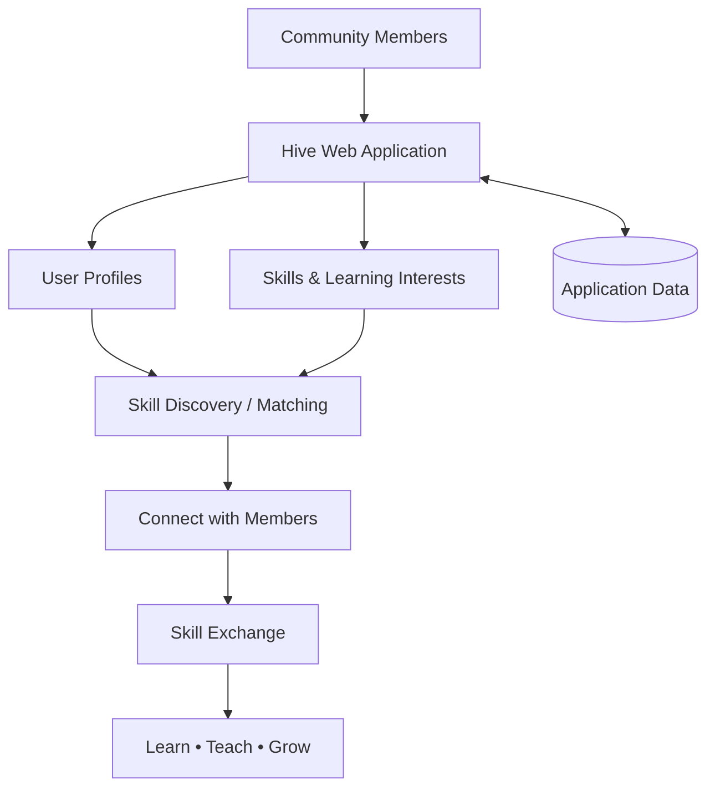

<div align="center">

# 🐝 HIVE — Community Skill Exchange Platform

### Learn together. Teach freely. Grow collectively.


[](https://hivelearn-app.onrender.com)

</div>

---

## 🌟 About Hive

**Hive is a community skill-exchange platform** where people connect to teach skills they know and learn skills they want to develop.

The idea is simple: everyone has something to teach and something to learn. Hive encourages people to exchange knowledge, discover learning partners, and grow together — without making money the centre of the learning experience.

## 💡 Why Hive?

Learning opportunities can be expensive, and finding the right person to learn from is not always easy. At the same time, people have valuable knowledge that they could share with others.

Hive aims to bridge this gap by:

- 🤝 Encouraging peer-to-peer learning and skill exchange.
- 🔎 Helping people discover skills and potential learning partners.
- 🌱 Creating a community where everyone can be both a teacher and a learner.

## ✨ Core Concept

1. Create a profile.
2. Add the skills you can teach.
3. Choose the skills you want to learn.
4. Discover people with complementary skills.
5. Connect and arrange a skill exchange.

## 🏗️ System Architecture

The diagram below shows the **high-level conceptual flow** of the platform.



## 🧰 Tech Stack

> Replace the placeholders with the technologies actually used in this project. Use logo badges so the stack is easy to scan.

| Layer | Technology |
|---|---|
| Frontend | `` |
| Backend | `` |
| Database | `` |
| Deployment |  |
| Version Control |   |

## 🚀 Live Demo

Explore the deployed application:

**[https://hivelearn-app.onrender.com](https://hivelearn-app.onrender.com)**

## 💻 Run Locally

```bash
# Clone the repository
git clone https://github.com/<your-username>/<your-repository>.git

# Open the project folder
cd <your-repository>
```

Install dependencies and start the application using the commands for the technologies configured in this repository.

## 🔮 Future Scope

- ⭐ Ratings and feedback for skill exchanges.
- 📅 Session scheduling and availability.
- 🔔 Notifications for requests and matches.
- 🏆 Learning progress and achievements.
- 🧠 More personalised skill recommendations.

## 🤝 Contributing

Suggestions and contributions are welcome. Fork the repository, create a feature branch, make your changes, and submit a pull request.

## 📄 License

Add a `LICENSE` file if you intend to publish this project under an open-source license.

---

<div align="center">

### 🐝 Share knowledge. Build connections. Grow together.

**Welcome to Hive!**

</div>
