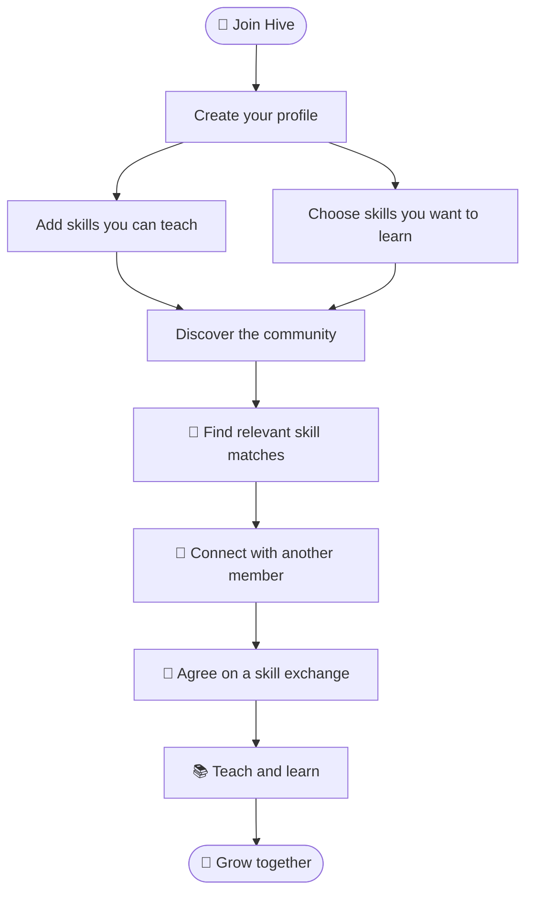
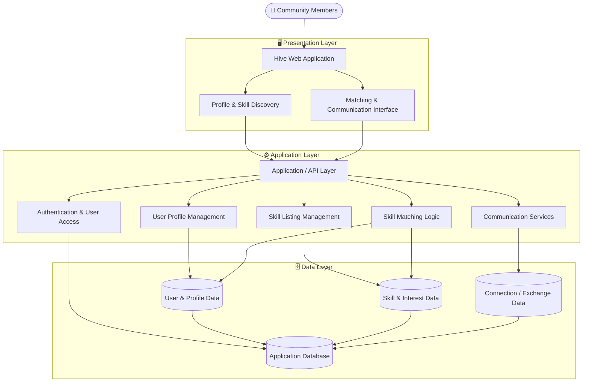
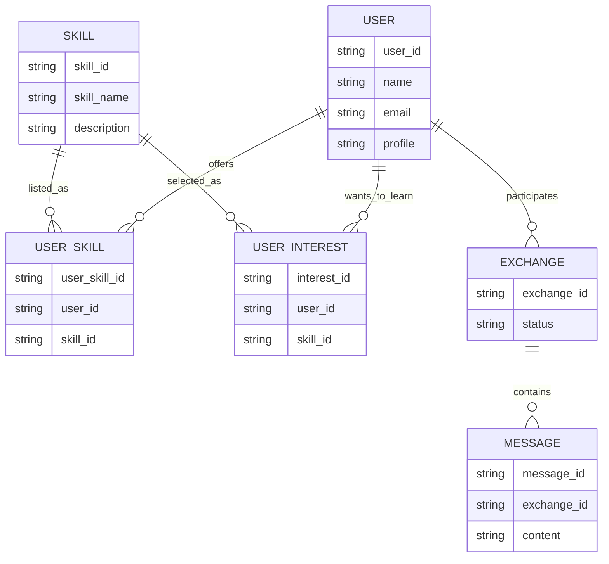
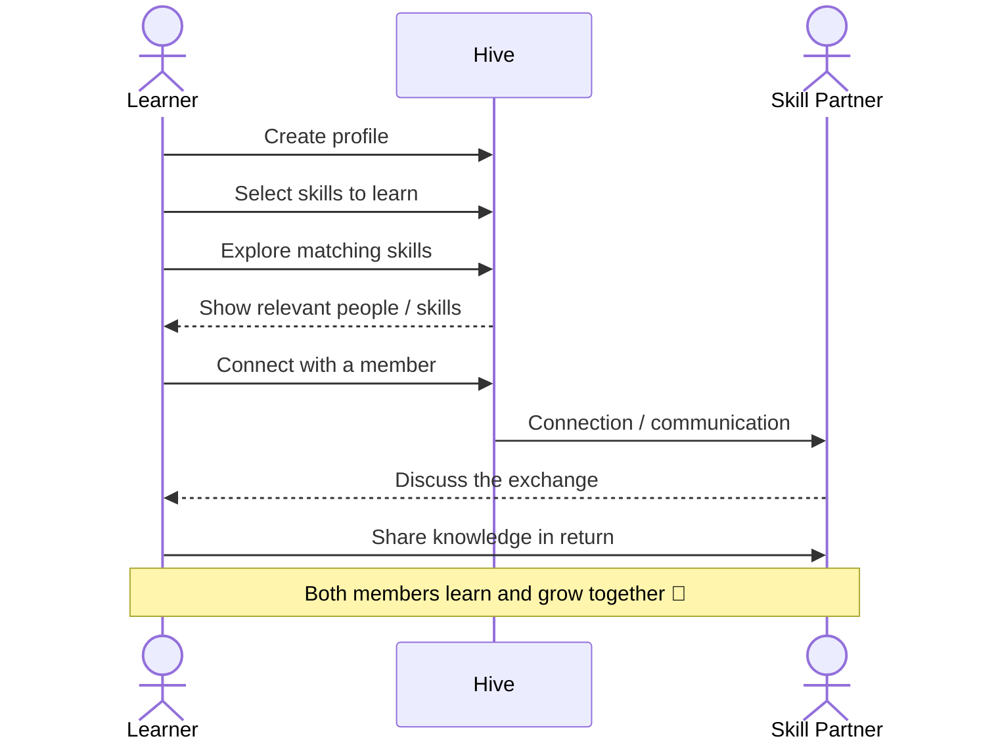

::: {align="center"}
# 🐝 HIVE --- Community Skill Exchange Platform

### Learn together. Teach freely. Grow collectively.

```{=html}
<p>
```
``{=html}
```{=html}
</p>
```
```{=html}
<p>
```
`<a href="https://hivelearn-app.onrender.com">`{=html}``{=html}`</a>`{=html}
``{=html}
``{=html}
```{=html}
</p>
```
**Hive is a community-driven platform where people exchange skills,
share knowledge, and help one another grow --- without making money the
barrier to learning.**

[Explore the Live App](https://hivelearn-app.onrender.com) · [Report an
Issue](../../issues) · [Request a Feature](../../issues)
:::

------------------------------------------------------------------------

## 📌 Table of Contents

-   [🌟 What is Hive?](#-what-is-hive)
-   [💡 Why We Built Hive](#-why-we-built-hive)
-   [🎯 Our Vision](#-our-vision)
-   [⚙️ How Hive Works](#️-how-hive-works)
-   [✨ Core Features](#-core-features)
-   [🏗️ System Architecture](#️-system-architecture)
-   [🔄 User Journey](#-user-journey)
-   [🧰 Technology Stack](#-technology-stack)
-   [📁 Project Structure](#-project-structure)
-   [🚀 Getting Started](#-getting-started)
-   [🖥️ Live Demo](#️-live-demo)
-   [🔮 Future Enhancements](#-future-enhancements)
-   [🤝 Contributing](#-contributing)
-   [👥 Team](#-team)
-   [📄 License](#-license)

------------------------------------------------------------------------

## 🌟 What is Hive?

**Hive is a Community Skill Exchange Platform** built around a simple
idea: everyone knows something that someone else wants to learn.

Traditional learning platforms usually focus on consuming courses or
paying for instruction. Hive explores a more collaborative approach:
people can offer skills they already have and connect with others who
can help them learn something new.

A user might offer to teach Python, photography, video editing, or a
language, while looking for help with public speaking, UI/UX design, or
another skill. Hive helps bring these people together so that learning
can become a two-way exchange.

The platform is designed to connect people through:

-   👤 **User profiles** --- introduce yourself, your interests, and the
    skills you can share.
-   🧩 **Skill listings** --- make skills available to the community and
    discover what others offer.
-   🎯 **Intelligent matching** --- help learners find people whose
    skills and learning interests align.
-   💬 **Communication tools** --- make it easier for members to connect
    and coordinate an exchange.

> **The Hive philosophy:** Every person is both a learner and a teacher.

## 💡 Why We Built Hive

Knowledge and talent exist everywhere, but access to learning
opportunities is not always equal.

Many people want to learn a practical skill but may not be able to
afford courses, coaching, or one-to-one tutoring. At the same time,
countless people have valuable skills they would happily share if they
had a simple way to connect with interested learners.

We built Hive to help bridge that gap.

### The problem

-   💸 **Cost can be a barrier:** Learning opportunities may require
    subscriptions, course fees, or tutoring payments.
-   🔍 **Finding the right person is difficult:** Learners may struggle
    to find someone who can teach exactly what they need.
-   🧠 **Knowledge is under-shared:** People have useful skills but lack
    a dedicated community to exchange them.
-   🔗 **Learning can feel isolated:** Many digital learning experiences
    lack direct peer-to-peer interaction.

### Our approach

Hive encourages a community-based, non-monetary model in which members
exchange knowledge and skills. Instead of treating every interaction as
a transaction, the platform puts people, collaboration, and shared
growth at the centre.

### The impact we want to create

  -----------------------------------------------------------------------
  Challenge                           Hive's approach
  ----------------------------------- -----------------------------------
  Learning feels expensive            Encourage non-monetary skill
                                      exchange

  It is hard to find a mentor or peer Connect people through skill
                                      profiles and listings

  People don't know what others can   Make community skills discoverable
  teach                               

  Learning lacks personal interaction Support communication between
                                      members
  -----------------------------------------------------------------------

## 🎯 Our Vision

To build an inclusive learning community where knowledge is accessible,
skills are valued, and everyone has an opportunity to teach and learn.

We believe a person's ability to learn should not be limited by their
ability to pay. Hive aims to make learning more human, collaborative,
and community-powered.

**Learn something. Teach something. Make someone's day. Repeat.** 🐝

## ⚙️ How Hive Works

The basic idea behind Hive is a skill exchange:

1.  **Create your profile** --- introduce yourself and your interests.
2.  **Add skills you can teach** --- share the knowledge or abilities
    you can offer.
3.  **Explore skills you want to learn** --- discover people and skills
    in the community.
4.  **Find a suitable connection** --- use the platform's matching and
    discovery experience.
5.  **Connect and communicate** --- discuss the learning goals and
    exchange details.
6.  **Learn and share** --- teach someone, learn something new, and
    strengthen the community.



## ✨ Core Features

> The following describes the platform's core product capabilities.
> Refer to the live application for the current user-facing
> implementation.

### 👤 User Profiles

A member profile helps people understand who they are connecting with,
what they know, and what they want to learn.

### 🧩 Skill Listings

Members can showcase skills they are willing to teach and discover
skills offered by others.

### 🎯 Intelligent Skill Matching

Hive is designed to help connect people based on the relationship
between skills they offer and skills they want to learn.

### 💬 Communication

Communication tools help members connect and coordinate their potential
skill exchanges.

### 🌍 Community-Driven Learning

The platform is built around peer-to-peer knowledge sharing and a
non-monetary exchange philosophy.

## 🏗️ System Architecture

The following is a **high-level logical architecture** of Hive. It
illustrates the main responsibilities and the flow of information; it is
not intended to claim a specific framework, database, or deployment
topology.



### 🧱 Architecture Components

  -----------------------------------------------------------------------
  Component                           Responsibility
  ----------------------------------- -----------------------------------
  Presentation layer                  Provides the user interface and
                                      interaction experience

  Application/API layer               Handles application requests and
                                      coordinates platform functionality

  Authentication                      Manages user identity and access

  Profile management                  Handles member information and
                                      skill interests

  Skill management                    Organises skills offered and skills
                                      users want to learn

  Matching logic                      Identifies potentially relevant
                                      skill-exchange connections

  Communication                       Supports interaction between
                                      community members

  Data layer                          Stores and retrieves application
                                      information
  -----------------------------------------------------------------------

### 🔐 Conceptual Data Relationships

The following conceptual model shows the key information areas in a
skill exchange platform. It is illustrative; adjust it to match the
actual database schema.



## 🔄 User Journey



## 🧰 Technology Stack

The exact technology names should reflect the tools used in the
repository. Fill in this table before publishing so the README
accurately documents the implementation.

  Layer             Technology
  ----------------- ----------------------------------------
  Frontend          `Add your frontend framework`
  Backend           `Add your backend framework / runtime`
  Database          `Add your database`
  Authentication    `Add your authentication solution`
  Styling / UI      `Add your styling tools`
  Deployment        Render (live application hosting)
  Version Control   Git & GitHub

## 📁 Project Structure

The structure below is a **documentation template**, not a verified
listing of the repository. Replace it with the actual folders and files
in your project.

``` text
Hive/
├── frontend/              # User interface
│   ├── public/             # Static assets
│   └── src/                # Frontend source code
├── backend/                # Server-side application
│   ├── routes/             # API routes
│   ├── controllers/        # Request handling
│   ├── models/              # Data models
│   └── config/              # Configuration
├── docs/                   # Project documentation
├── .env.example            # Example environment variables
├── .gitignore
└── README.md
```

## 🚀 Getting Started

Want to run Hive locally? Follow these steps after cloning the
repository.

### Prerequisites

Install the tools required by the actual project:

-   Git
-   The runtime required by your project (for example, Node.js or
    Python)
-   The database used by your application
-   A code editor such as Visual Studio Code

### 1. Clone the repository

``` bash
git clone https://github.com/<your-username>/<your-repository>.git
cd <your-repository>
```

### 2. Install dependencies

Use the commands matching your actual project.

For a Node.js project:

``` bash
npm install
```

For a Python project:

``` bash
pip install -r requirements.txt
```

### 3. Configure environment variables

Create a `.env` file using the variables required by the application.

``` env
# Add the environment variables required by your project.
# Never commit real credentials, API keys, or database passwords.
```

If the project has a `.env.example` file, use it as the source of truth.

### 4. Run the application

Use the start commands defined in your project's `package.json`,
`pyproject.toml`, or other configuration.

For example, a Node.js project may use:

``` bash
npm run dev
```

A Python project may use:

``` bash
python app.py
```

> ⚠️ These are examples, not verified Hive commands. Check the
> repository's scripts and setup files before using them.

## 🖥️ Live Demo

Experience Hive here:

::: {align="center"}
### 🐝 [Open Hive --- Live Application](https://hivelearn-app.onrender.com)

*Discover skills. Meet people. Exchange knowledge.*

`<a href="https://hivelearn-app.onrender.com">`{=html}
``{=html}
`</a>`{=html}
:::

### 📸 Screenshots

Add screenshots of the actual application here. These help visitors
understand the product before opening the live demo.

``` md
<!-- Replace the paths below with screenshots committed to your repository. -->


```

## 🔮 Future Enhancements

Potential directions for evolving the platform include:

-   ⭐ Member ratings, reviews, and exchange feedback
-   📅 Scheduling and availability management
-   🔔 Notifications for new matches and connection requests
-   🧠 More personalised skill recommendations
-   🏆 Learning milestones, achievements, and progress tracking
-   🛡️ Improved reporting, moderation, and community safety
-   📱 Enhanced mobile experience

*These are potential enhancements, not claims about currently released
features.*

## 🤝 Contributing

We believe learning is better when people build together.

Contributions, ideas, bug reports, and feature suggestions are welcome.

1.  Fork the repository.

2.  Create a branch for your change.

    ``` bash
    git checkout -b feature/your-feature-name
    ```

3.  Make your changes and test them.

4.  Commit your work.

    ``` bash
    git commit -m "Add: your feature description"
    ```

5.  Push your branch.

    ``` bash
    git push origin feature/your-feature-name
    ```

6.  Open a Pull Request describing your changes.

## 👥 Team

Hive is a collaborative project built with the goal of making
peer-to-peer learning more accessible.

Add your project contributors here:

  ----------------------------------------------------------------------------------------------------
  Name                    Role                    GitHub
  ----------------------- ----------------------- ----------------------------------------------------
  `Your Name`             Project Lead /          [@your-username](https://github.com/your-username)
                          Developer               

  `Contributor Name`      Developer / Contributor [@username](https://github.com/username)
  ----------------------------------------------------------------------------------------------------

## 📄 License

Choose and add the license that applies to this repository (for example,
MIT). Until a license file is added, don't assume that the project is
open for reuse under a particular license.

------------------------------------------------------------------------

::: {align="center"}
## 🐝 A little knowledge can create a big impact.

**Don't just learn. Exchange. Empower. Evolve.**

### Welcome to Hive.

[🌐 Visit Hive](https://hivelearn-app.onrender.com)

`<sub>`{=html}Made with ❤️ for a world that learns
together.`</sub>`{=html}
:::
